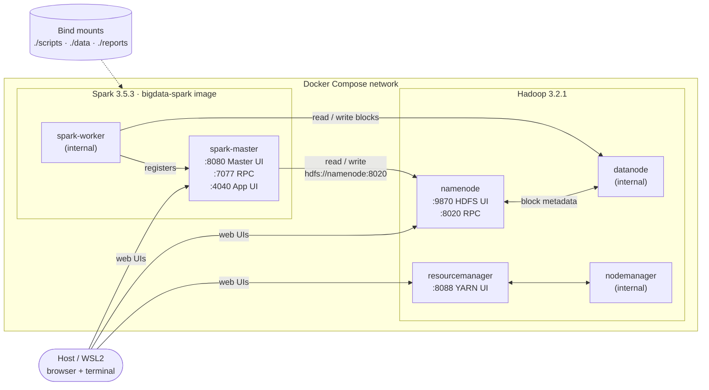
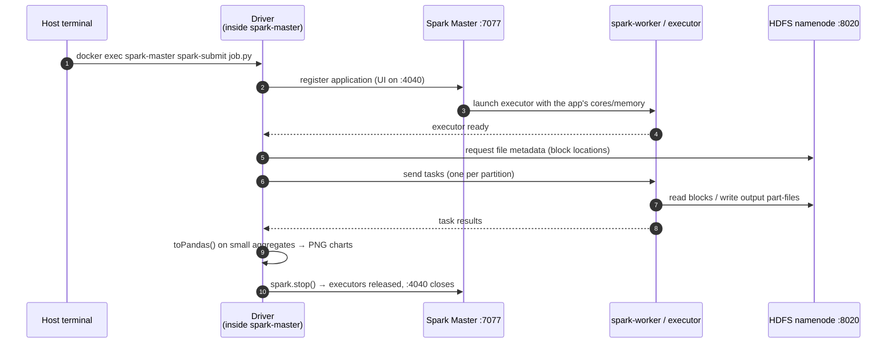
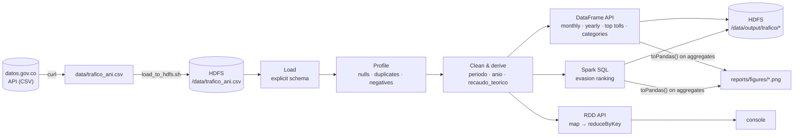

# Big Data Pipeline: HDFS + Spark on Docker

A containerized, pseudo-distributed Big Data stack (Hadoop HDFS + Apache Spark) for
batch analysis of public datasets, built as a reproducible alternative to manual
VM-based Hadoop installations.

The repository grows in phases on the same infrastructure:

| Phase | Job | Dataset | Status |
|---|---|---|---|
| 2 | `scripts/analyze.py` — basic DataFrame operations | [Tarifas de Peajes ANI](https://www.datos.gov.co/Transporte/Tarifas-de-Peajes-ANI/7gj8-j6i3) (1,114 rows) | Done |
| 3a | `scripts/analyze_traffic.py` — batch EDA with DataFrame, Spark SQL and RDD | [Tráfico Vehicular ANI](https://www.datos.gov.co/Transporte/Tr-fico-Vehicular-ANI/8yi9-t44c) (149,944 rows) | Done |
| 3b | Real-time toll events with Kafka + Spark Structured Streaming | Simulated toll events | In progress |

## Glossary

Key terms used throughout this project, for quick reference before diving into
the architecture or the walkthrough.

| Term | Meaning |
|---|---|
| **Big Data** | Datasets whose volume, velocity, or variety exceed what traditional single-machine tools can efficiently capture, store, or process. |
| **HDFS** (Hadoop Distributed File System) | Hadoop's distributed storage layer. Splits files into blocks and replicates them across multiple nodes for fault tolerance and parallel access. |
| **NameNode** | HDFS's master node. Holds the filesystem's metadata (directory tree, block locations, permissions) but not the data itself. |
| **DataNode** | HDFS's worker node. Stores the actual data blocks and serves read/write requests from clients. |
| **YARN** (Yet Another Resource Negotiator) | Hadoop's resource manager. Allocates cluster CPU/memory to applications independently of the storage layer. |
| **ResourceManager** | YARN's master process. Tracks cluster-wide resource availability and grants containers to applications. |
| **NodeManager** | YARN's per-node agent. Monitors local resource usage and reports back to the ResourceManager. |
| **MapReduce** | Hadoop's original distributed processing model: a *Map* phase transforms data in parallel, a *Reduce* phase aggregates the results. Superseded here by Spark. |
| **Apache Spark** | In-memory distributed processing engine. Faster than MapReduce for iterative workloads because it avoids writing intermediate results to disk. |
| **Spark Master** | Coordinates a Spark standalone cluster: tracks connected workers and assigns resources to submitted applications. |
| **Spark Worker** | A node that executes tasks assigned by the Spark Master, running one or more executors. |
| **Executor** | A JVM process launched by a worker to run tasks for a specific Spark application. |
| **Driver** | The process running the `main()` of a Spark application. In **client mode** (used here), the driver runs where `spark-submit` was launched — inside the `spark-master` container. |
| **RDD** (Resilient Distributed Dataset) | Spark's low-level abstraction: an immutable, partitioned collection rebuilt from its lineage if a partition is lost. |
| **DataFrame** | Spark's structured abstraction: a distributed table with named columns, optimized by the Catalyst query planner. |
| **Spark SQL** | Module to query DataFrames with SQL, sharing the same optimizer and execution engine. |
| **Shuffle** | Redistribution of data across partitions, triggered by wide operations such as `groupBy` or `reduceByKey`; the most expensive step in a Spark job. |
| **PySpark** | The Python API for Apache Spark. |
| **`spark-submit`** | The command-line tool used to launch a Spark application against a cluster. |
| **Pseudo-distributed mode** | All Hadoop/Spark daemons run as separate processes (here, containers) on a single physical machine — for learning and development, not production scale. |
| **Docker Compose** | Tool for defining and running multi-container applications from a single YAML file. |
| **Bind mount** | Maps a host directory (e.g. `./scripts`) into a container path (e.g. `/scripts`), so host edits are immediately visible inside the container. |
| **Web UI / RPC port** | **Web UI** ports serve a browser dashboard (e.g. `9870`, `8080`); **RPC** ports carry process-to-process traffic and have no browser interface (e.g. `8020`, `7077`). |

## Architecture



Single-node pseudo-distributed cluster: `namenode`, `datanode`, `resourcemanager`,
`nodemanager` (Hadoop 3.2.1), `spark-master`, `spark-worker` (Apache Spark 3.5.3,
custom image `bigdata-spark:3.5.3` with pandas and matplotlib for chart generation).

## How a job runs (client mode)



Because the driver runs inside `spark-master` (client mode), it holds the
application's cores until `spark.stop()`. A second `spark-submit` launched meanwhile
sits in `WAITING` (see Troubleshooting).

## Web UIs and ports

| Port | Service | Purpose |
|---|---|---|
| **9870** | HDFS NameNode Web UI | Browse the distributed filesystem, check block/node health, capacity. |
| **8020** | HDFS RPC (NameNode) | Client↔NameNode communication (`hdfs://namenode:8020/...`). No web UI. |
| **8088** | YARN ResourceManager Web UI | Monitor cluster resource usage and applications. |
| **7077** | Spark Master (RPC) | Endpoint workers and `spark-submit` connect to (`spark://spark-master:7077`). No web UI. |
| **8080** | Spark Master Web UI | Connected workers, running/completed applications, available cores/memory. |
| **4040** | Spark Application UI (driver) | **Only exists while an application is running.** Jobs, stages, tasks and the execution DAG. |

## Prerequisites

- Docker Engine + Docker Compose v2
- ~4 GB RAM available for containers
- `curl` to download the datasets

## Quick start

```bash
git clone https://github.com/crabb-beltran/bigdata-hadoop-spark.git
cd bigdata-hadoop-spark

chmod 777 reports reports/figures      # the Spark container (uid 185) writes charts here
docker compose up -d --build
docker compose ps                      # wait until namenode shows "healthy"
```

## Phase 3a — Batch analysis of toll traffic

### Problem

How have vehicle traffic and estimated toll revenue evolved at the national road
tolls managed by the Agencia Nacional de Infraestructura (ANI) between 2014 and
2026, and in which stations and vehicle categories do evasion and exemptions
concentrate?

### Dataset

[Tráfico Vehicular ANI](https://www.datos.gov.co/Transporte/Tr-fico-Vehicular-ANI/8yi9-t44c),
published on Colombia's open data portal. Grain: one row per toll station ×
tariff category × month.

| Attribute | Value |
|---|---|
| Rows | 149,944 |
| Period | January 2014 – May 2026 |
| Toll stations | 162 |
| Tariff categories | 55 |
| Columns | `idpeaje`, `peaje`, `categoriatarifa`, `desde`, `hasta`, `valortarifa`, `cantidadtrafico`, `cantidadevasores`, `cantidadexentos787` |

### Run

```bash
# 1. Download (the $limit parameter is required: the API returns 1,000 rows by default)
curl -L -o data/trafico_ani.csv \
  "https://www.datos.gov.co/resource/8yi9-t44c.csv?\$limit=200000"
wc -l data/trafico_ani.csv               # expected: 149945

# 2. Load into HDFS
./scripts/load_to_hdfs.sh data/trafico_ani.csv /data

# 3. Run the batch job
docker exec spark-master /opt/spark/bin/spark-submit \
  --master spark://spark-master:7077 \
  /scripts/analyze_traffic.py 2>&1 | tee reports/run_batch.log
```

Outputs:
- Aggregated CSVs in HDFS under `/data/output/trafico/` (`mensual`, `anual`,
  `top_peajes_trafico`, `top_peajes_evasion`, `participacion_categoria`).
- Charts in `reports/figures/`.

### Pipeline



1. **Load** from HDFS with an explicit schema (no `inferSchema`: avoids a second
   pass over the file and pins column types; numeric columns are read as double so
   malformed values surface as nulls in the profile instead of being truncated).
2. **Profile** data quality: row count, duplicates, nulls per column, negative values.
3. **Clean**: drop duplicates, normalize text, parse the period date, filter invalid
   rows, derive `anio`, `mes`, `recaudo_teorico` and `grupo_categoria`.
4. **Analyze** with the three Spark APIs:
   - **DataFrame** — monthly series, yearly summary (flags incomplete years), top tolls
     by traffic, traffic share by category.
   - **Spark SQL** — evasion ranking (evaders per 1,000 vehicles, tolls with ≥ 1 M
     accumulated vehicles to avoid small-denominator noise).
   - **RDD** — the same category aggregation with `map` → `reduceByKey` →
     `takeOrdered`, to contrast both abstractions.
5. **Persist** aggregates to HDFS and render charts from them (`toPandas()` is applied
   only to aggregates under 200 rows, never to the full dataset).

`spark.sql.shuffle.partitions` is set to 16: at ~150k rows the default of 200 only
adds task-scheduling overhead.

### Results

**Data quality** — 149,944 rows, no nulls, no duplicates, no negative values; cleaning
discarded 0 rows.


- **COVID-19 impact**: traffic fell from 235.5 M vehicles in 2019 to 179.5 M in 2020
  (−23.8 %), and was already above the 2019 level in 2021 (246.8 M).


- **Revenue grew faster than traffic**: 2014 → 2025, traffic grew 1.42× (218.5 M →
  310.2 M) while theoretical revenue grew 2.70× (COP 2.18 → 5.89 trillion), pointing
  to tariff increases above vehicle growth.


- **Traffic concentration**: Andes (154 M) and Chusacá (99.5 M), both access tolls
  to Bogotá, lead the accumulated ranking.


- **Reported evasion is highly concentrated**: Puente Amarillo (7.73 per 1,000) and
  San Pedro (7.69) stand far above the rest; from the 5th place on, the rate drops
  below 0.25.


- **Category mix**: category I (cars, jeeps, pickups) carries 63.3 % of traffic,
  followed by II (12.9 %) and special categories (6.3 %).

### Analytical caveats

- **`recaudo_teorico` is an upper bound** (traffic × tariff). It does not subtract
  exempt vehicles, because the dataset does not state whether they are included in
  `cantidadtrafico`.
- **Coverage changes over time**: active tolls go from 96 (2014) to 133 (2025) and
  dip from 122 to 105 between 2017 and 2019. Part of the yearly growth comes from
  stations entering or leaving the dataset, not from more traffic per station. The
  2020 drop is real: active stations barely changed versus 2019.
- **Evasion is likely under-reported**: only four stations show material rates,
  which suggests many concessions report zero evaders. Results describe *reported*
  evasion.

### Tariff category dictionary (`categoriatarifa`)

| Code | Meaning |
|---|---|
| I | Cars, jeeps, pickups, minibuses (single-tire axles) |
| II | Buses, minibuses (dual rear axle), two-axle trucks |
| III | Trucks and passenger vehicles with 3–4 axles |
| IV | Five-axle trucks |
| V | Six-axle trucks |
| VI–VII | Larger trucks (up to 7+ axles, varies by concession) |
| IE, IE1, IE2, … | Category I with special/discounted rate |
| IIE, IIIE, IVE, VE, VIE | Categories II–VI with special rate |
| EA, EC, EG, ER, E1-*, E2-* | Concession-specific categories (additional axles, special tariffs) |

> Special categories have no single nationally standardized definition — they vary by
> Ministry of Transport resolution and by concession. The batch job groups them as
> `ESPECIALES`.

## Phase 2 — Basic DataFrame operations

```bash
curl -L -o data/peajes_ani.csv \
  "https://www.datos.gov.co/resource/7gj8-j6i3.csv?\$limit=50000"
./scripts/load_to_hdfs.sh data/peajes_ani.csv /data

docker exec spark-master /opt/spark/bin/spark-submit \
  --master spark://spark-master:7077 \
  /scripts/analyze.py \
  --input hdfs://namenode:8020/data/peajes_ani.csv \
  --output hdfs://namenode:8020/data/output/high_value \
  --output-agg hdfs://namenode:8020/data/output/by_category
```

Schema inference, sample rows, `summary()`, a value filter, a sorted top 10 and a
`groupBy` per tariff category, with results written back to HDFS.

## Project structure

```
.
├── docker-compose.yml
├── docker/
│   └── spark/Dockerfile        # apache/spark:3.5.3-python3 + pandas, matplotlib
├── config/
│   └── hadoop.env              # Hadoop cluster environment variables
├── data/                       # local CSVs (gitignored)
├── reports/
│   └── figures/                # charts produced by the batch job (versioned)
├── scripts/
│   ├── load_to_hdfs.sh         # generic CSV → HDFS loader
│   ├── analyze.py              # Phase 2 job
│   └── analyze_traffic.py      # Phase 3a batch job
└── README.md
```

## Video walkthrough checklist

Suggested order for a walkthrough under 5 minutes:

1. **Cluster startup** — `docker compose ps` with all services `healthy`/`running`.
2. **HDFS Web UI (`localhost:9870`)** — Utilities → Browse the file system → `/data`.
3. **Load to HDFS** — run `load_to_hdfs.sh` live.
4. **Spark Master UI (`localhost:8080`)** — 1 worker `ALIVE` before submitting.
5. **Code walkthrough** — schema, cleaning, the DataFrame / Spark SQL / RDD sections.
6. **Run the job** — quality profile, yearly summary, rankings, RDD output.
7. **Spark Application UI (`localhost:4040`)** — Jobs tab and one stage's DAG while
   the job runs (hold the driver open with a temporary `input()` before
   `spark.stop()` if needed; remove it before committing).
8. **Results** — `hdfs dfs -ls /data/output/trafico` and the charts in `reports/figures/`.

## Design decisions & trade-offs

- **Docker instead of VirtualBox**: the course instructions describe a manual
  VirtualBox + Ubuntu Server + PuTTY setup. This project replicates the same
  pseudo-distributed HDFS + Spark architecture with containers, for reproducibility.
- **`bde2020/hadoop-*` images**: de facto standard for Hadoop-in-Docker demos;
  unmaintained since ~2021 (Hadoop 3.2.1). Fine for learning, **not** for production.
- **`apache/spark` (official) instead of `bitnami/spark`**: Bitnami discontinued free
  public tags on Docker Hub in 2025. The official image has no `SPARK_MODE` entrypoint
  logic, so `command:` is set explicitly per service, and `spark-submit` is invoked by
  full path because it isn't on `$PATH`.
- **Custom Spark image pinned to 2023 library versions**: `apache/spark:3.5.3-python3`
  ships **Python 3.8**, so the newest compatible releases are `pandas==2.0.3` and
  `matplotlib==3.7.5`.
- **Charts rendered on the driver from aggregates**: Spark does the heavy lifting;
  only small aggregated results are converted to pandas.
- **`dfs.replication=1`**: single datanode. A real multi-node deployment would use 3.
- **No object storage**: HDFS is kept to match the learning objective. In production,
  S3/GCS + a table format (Iceberg/Delta) would replace it.

## Known limitations

- Single-node cluster: no fault-tolerance testing, no NameNode HA.
- No monitoring/alerting stack — logs only via `docker compose logs <service>`.
- `load_to_hdfs.sh` overwrites the destination file (`-put -f`); a real ingestion
  pipeline would need versioning or deduplication.
- HDFS write permissions are opened to `777` on the target directory — acceptable for
  a single-user practice cluster without Kerberos, not for a shared environment.
- Special tariff categories lack a single authoritative public definition.

## Troubleshooting

**`docker compose up` fails with "undefined volume"**
`volumes:` must be a top-level key (same indentation as `services:`).

**`namenode` never becomes healthy**
Usually a stale `hadoop_namenode` volume created with a different `CLUSTER_NAME`.
`docker compose down -v && docker compose up -d` resets it (and deletes HDFS data).

**Image build fails: `No matching distribution found for pandas==...`**
The base image runs Python 3.8; pandas ≥ 2.1 and matplotlib ≥ 3.8 require ≥ 3.9.
Keep the versions pinned in `docker/spark/Dockerfile`.

**`"spark-submit": executable file not found in $PATH`**
Use the full path: `docker exec spark-master /opt/spark/bin/spark-submit ...`.

**`./scripts/load_to_hdfs.sh: Permission denied`**
The script lost its executable bit: `chmod +x scripts/load_to_hdfs.sh`.

**Job fails at `mkdirs` with `AccessControlException: user=spark, access=WRITE`**
The data was loaded as `root`, leaving the HDFS directory at `755`, while the Spark
driver runs as `spark`. `load_to_hdfs.sh` now runs `chmod -R 777` on the target
directory; for directories created manually:
`docker exec namenode hdfs dfs -chmod -R 777 /data`.

**Charts are not written to `reports/figures/` (`Permission denied`)**
The container user (uid 185) can't write to a host directory owned by your user:
`chmod 777 reports reports/figures`.

**`python3: can't open file '/scripts/...'` or port `4040` not reachable**
The container was created before the current `volumes:`/`ports:` definition.
`docker compose restart` does not re-read the compose file — recreate instead:
`docker compose up -d --force-recreate spark-master spark-worker`.

**A job sits in `WAITING` with 0 cores**
A previous driver (e.g. paused on `input()`) still holds all cores. Return to that
terminal and press Enter, or `docker exec spark-master ps aux | grep java` and kill
the driver PID. The UI "kill" link only works for cluster-mode submissions; this
project uses client mode.

**`localhost:4040` refuses the connection**
The application UI only lives while a `SparkContext` is active — the job already
finished.

## License

MIT