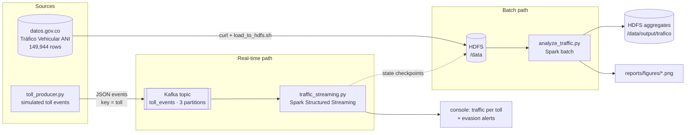

# Big Data Pipeline: HDFS + Spark + Kafka on Docker

A containerized, pseudo-distributed Big Data stack that analyzes Colombian toll
traffic in **batch** (Hadoop HDFS + Apache Spark) and in **real time** (Apache Kafka +
Spark Structured Streaming). Built as a reproducible alternative to manual VM-based
installations.

**Question it answers:** how have vehicle traffic and estimated toll revenue evolved
at the national road tolls managed by the ANI (2014–2026), and where does evasion
concentrate — historically and as events arrive?

## The big picture



## Phases

| Phase | Script | What it does | Data |
|---|---|---|---|
| 2 | `scripts/analyze.py` | Basic DataFrame operations | [Tarifas de Peajes ANI](https://www.datos.gov.co/Transporte/Tarifas-de-Peajes-ANI/7gj8-j6i3) (1,114 rows) |
| 3a | `scripts/analyze_traffic.py` | Batch EDA with DataFrame, Spark SQL and RDD | [Tráfico Vehicular ANI](https://www.datos.gov.co/Transporte/Tr-fico-Vehicular-ANI/8yi9-t44c) (149,944 rows) |
| 3b | `scripts/toll_producer.py` + `scripts/traffic_streaming.py` | Real-time traffic, revenue and evasion alerts per toll | Simulated events |

## Documentation

| Doc | Read it to understand |
|---|---|
| [Glossary](docs/00-glossary.md) | Every term used in the project, in one table |
| [Architecture](docs/01-architecture.md) | The 7 services, how they talk to each other, ports, volumes, design decisions |
| [Batch pipeline](docs/02-batch-pipeline.md) | How Spark executes the batch job (DAG, stages, shuffles) and what it found |
| [Streaming pipeline](docs/03-streaming-pipeline.md) | Kafka concepts mapped to this project, micro-batches, windows, watermark, checkpoints |
| [Runbook](docs/04-runbook.md) | Every command to run the project end to end, plus the demo script |
| [Troubleshooting](docs/05-troubleshooting.md) | Errors found while building it and how they were fixed |

## Quick start

Prerequisites: Docker Engine + Compose v2, ~6 GB free RAM, `curl`.

```bash
git clone https://github.com/crabb-beltran/bigdata-hadoop-spark.git
cd bigdata-hadoop-spark
chmod 777 reports reports/figures          # Spark (uid 185) writes charts here
docker compose up -d --build
docker compose ps                          # wait for namenode "healthy"
```

**Batch:**

```bash
curl -L -o data/trafico_ani.csv "https://www.datos.gov.co/resource/8yi9-t44c.csv?\$limit=200000"
./scripts/load_to_hdfs.sh data/trafico_ani.csv /data
docker exec spark-master /opt/spark/bin/spark-submit \
  --master spark://spark-master:7077 /scripts/analyze_traffic.py
```

**Real time** (two terminals; start the consumer first):

```bash
# terminal 1 — consumer
docker exec -it spark-master /opt/spark/bin/spark-submit \
  --master spark://spark-master:7077 \
  --packages org.apache.spark:spark-sql-kafka-0-10_2.12:3.5.3 \
  --conf spark.jars.ivy=/tmp/.ivy2 \
  /scripts/traffic_streaming.py

# terminal 2 — producer
docker exec -it spark-master python3 /scripts/toll_producer.py
```

Full step-by-step (topic creation, verification, reset): [Runbook](docs/04-runbook.md).

## Web UIs

| URL | Service | Look here for |
|---|---|---|
| http://localhost:9870 | HDFS NameNode | Files under `/data`, block health |
| http://localhost:8088 | YARN ResourceManager | Cluster resources |
| http://localhost:8080 | Spark Master | Workers, running/completed applications |
| http://localhost:4040 | Spark application (driver) | Jobs, stages, DAG, **Structured Streaming** tab — only while a job runs |

## Key results (batch)


- Traffic fell **23.8 %** in 2020 (COVID-19) and was above 2019 levels again in 2021.
- 2014 → 2025: traffic grew **1.42×**, theoretical revenue **2.70×** — tariffs rose
  faster than traffic.
- Reported evasion concentrates in two stations: Puente Amarillo (7.73 per 1,000)
  and San Pedro (7.69).
- Category I (cars) carries **63.3 %** of traffic.

All charts, caveats and the tariff-category dictionary: [Batch pipeline](docs/02-batch-pipeline.md).

## Project structure

```
.
├── docker-compose.yml          # 7 services: Hadoop (4), Spark (2), Kafka (1)
├── docker/spark/Dockerfile     # apache/spark:3.5.3-python3 + pandas, matplotlib, kafka-python
├── config/hadoop.env           # Hadoop configuration as environment variables
├── data/                       # downloaded CSVs (gitignored)
├── reports/figures/            # batch charts (versioned)
├── scripts/
│   ├── load_to_hdfs.sh         # CSV → HDFS loader (sets write permissions)
│   ├── analyze.py              # Phase 2 job
│   ├── analyze_traffic.py      # Phase 3a batch job
│   ├── toll_producer.py        # Phase 3b Kafka producer
│   └── traffic_streaming.py    # Phase 3b Spark Structured Streaming consumer
└── docs/                       # documentation (see table above)
```

## License

MIT