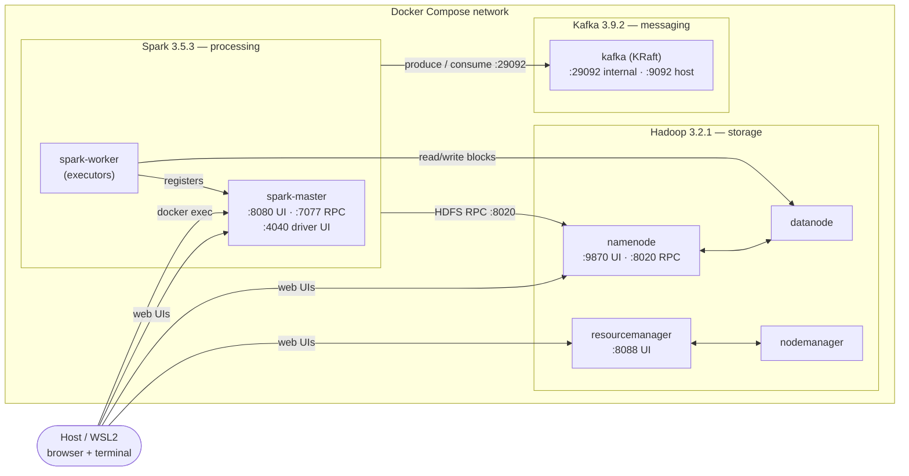
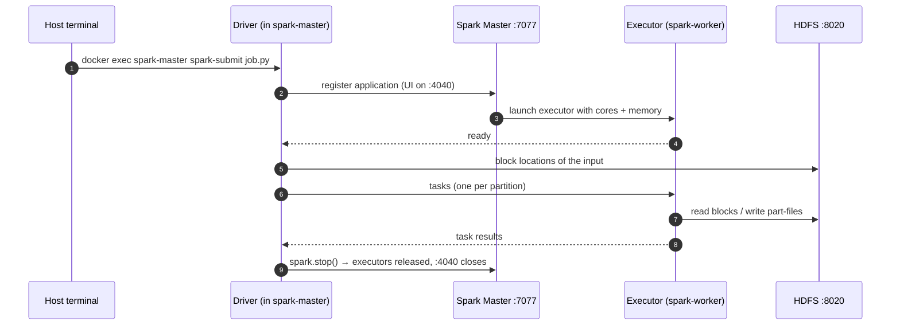

# Architecture

Seven containers on one Docker Compose network. Each service is reachable from the
others by its name (`namenode`, `kafka`, …) through Docker's internal DNS; only the
ports listed below are published to the host.



## Services

| Service | Image | Role | Published ports |
|---|---|---|---|
| `namenode` | `bde2020/hadoop-namenode` | HDFS metadata (file tree, permissions, block locations) | 9870 UI, 8020 RPC |
| `datanode` | `bde2020/hadoop-datanode` | HDFS block storage | — |
| `resourcemanager` | `bde2020/hadoop-resourcemanager` | YARN master | 8088 UI |
| `nodemanager` | `bde2020/hadoop-nodemanager` | YARN node agent | — |
| `spark-master` | `bigdata-spark:3.5.3` (custom) | Spark standalone master; hosts the **driver** of every job (client mode) and the producer | 8080 UI, 7077 RPC, 4040 driver UI |
| `spark-worker` | `bigdata-spark:3.5.3` (custom) | Runs the **executors** that process partitions | — |
| `kafka` | `apache/kafka:3.9.2` | Single broker + controller in KRaft mode | 9092 |

> YARN runs but is not used by the jobs: Spark is submitted to its own standalone
> master (`spark://spark-master:7077`). It stays in the stack because it is part of the
> Hadoop architecture the course studies.

## Who talks to whom

| From → To | Protocol / address | Used for |
|---|---|---|
| Driver → Spark Master | `spark://spark-master:7077` | Register the app, request executors |
| Worker → Spark Master | `spark://spark-master:7077` | Register the worker, receive executor launches |
| Driver / executors → NameNode | `hdfs://namenode:8020` | Ask where blocks are, create files, permissions |
| Executors → DataNode | internal data-transfer port | Read and write the actual bytes |
| Producer → Kafka | `kafka:29092` (INTERNAL listener) | Publish `toll_events` |
| Executors → Kafka | `kafka:29092` (INTERNAL listener) | Read partitions of `toll_events` |
| Host tools → Kafka | `localhost:9092` (EXTERNAL listener) | Optional: clients running on WSL |

**Why two Kafka listeners.** A client first connects to any address, then Kafka replies
with the *advertised* address to use from then on. Containers can resolve `kafka` but
the host cannot; the host can use `localhost` but containers cannot (inside a container
`localhost` is the container itself). Each side therefore gets its own listener.

## How a Spark job runs (client mode)



Consequence: the driver holds the application's cores until it stops. A second
`spark-submit` meanwhile waits in `WAITING` (the streaming job never stops by itself,
so run batch and streaming one at a time).

## Storage and volumes

| Path | Type | Content | Survives `docker compose down`? |
|---|---|---|---|
| `hadoop_namenode`, `hadoop_datanode` | Named volumes | HDFS metadata and blocks (`/data/...`) | Yes (deleted only with `down -v`) |
| `./scripts` → `/scripts` | Bind mount | Job code — edit on the host, run in the container | Host files |
| `./data` → `/data` | Bind mount | Downloaded CSVs (staging before HDFS) | Host files |
| `./reports` → `/reports` | Bind mount | Charts written by the batch driver | Host files |
| Kafka log dir | Container filesystem | Topic data | **No** — recreate the topic after `down` |

HDFS layout:

```
/data
├── trafico_ani.csv · peajes_ani.csv      # inputs (load_to_hdfs.sh)
├── output/trafico/{mensual,anual,…}      # batch aggregates
└── checkpoints/traffic/{per_toll,alerts} # streaming offsets + state
```

## Custom Spark image

`docker/spark/Dockerfile` extends `apache/spark:3.5.3-python3` (Python 3.8) with:

| Library | Version | Why |
|---|---|---|
| pandas | 2.0.3 | `toPandas()` on batch aggregates (last release for Python 3.8) |
| matplotlib | 3.7.5 | Batch charts (last release for Python 3.8) |
| kafka-python | 2.2.21 | Producer (the 2.0.2 used in the course annex breaks on Python ≥ 3.12) |

The Kafka connector for Spark (`spark-sql-kafka-0-10_2.12:3.5.3`) is **not** baked in:
`--packages` downloads it at submit time. Its Scala (2.12) and Spark (3.5.3) versions
must match the image.

## Design decisions & trade-offs

| Decision | Why | Trade-off |
|---|---|---|
| Docker instead of VirtualBox | Same pseudo-distributed architecture as the course annexes, reproducible with one command | Not the literal environment of the instructions |
| `bde2020/hadoop-*` images | De facto standard for Hadoop in Docker | Unmaintained since ~2021 (Hadoop 3.2.1) — learning only |
| Official `apache/spark` | Bitnami stopped publishing free tags in 2025 | No entrypoint logic: `command:` per service and full path to `spark-submit` |
| Kafka 3.9.2 in **KRaft** mode | Same version as the annex, without the extra ZooKeeper container; KRaft is the only mode from Kafka 4.0 | Annex screenshots show ZooKeeper |
| 3 partitions in `toll_events` | Shows partitioning and parallel consumption (3 read tasks) | One broker: no replication, no fault tolerance |
| Checkpoints in HDFS | Stateful streaming needs storage shared by driver and executors | Depends on HDFS being up |
| `dfs.replication=1`, permissions `777` | Single datanode, single user, no Kerberos | Never acceptable in a shared or production cluster |
| HDFS instead of object storage | Course learning objective | In production: S3/GCS + Iceberg/Delta |

## Known limitations

- One node per role: no NameNode HA, no broker replication, no failure testing.
- No monitoring stack — logs via `docker compose logs <service>` and the web UIs.
- `load_to_hdfs.sh` overwrites files (`-put -f`); no versioning or deduplication.
- Kafka topic data lives inside the container and is lost when it is removed.