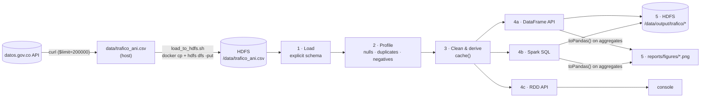
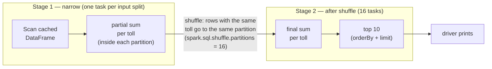
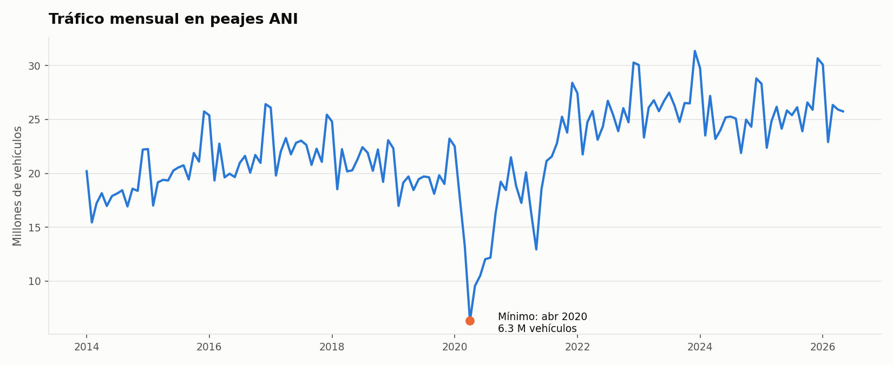
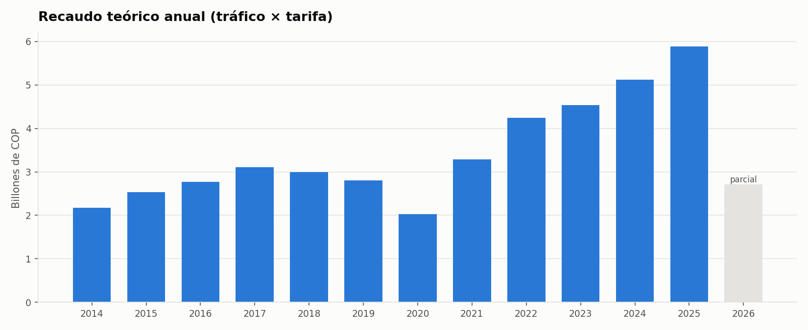
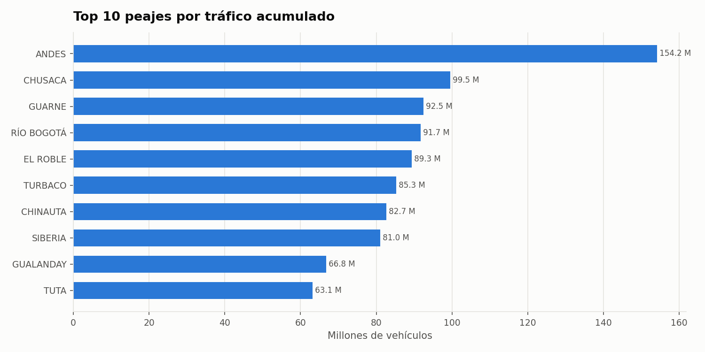
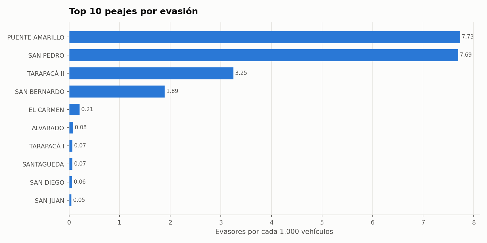
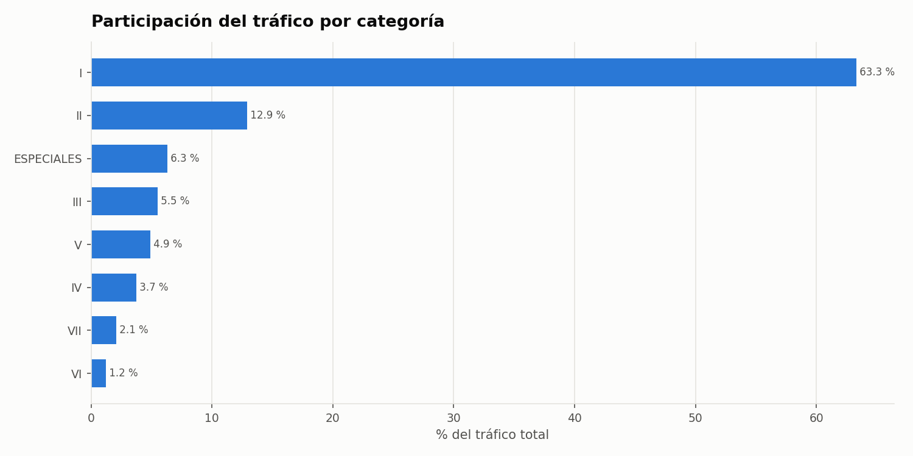

# Batch pipeline — `analyze_traffic.py`

**Question:** how have traffic and estimated revenue evolved at ANI tolls (2014–2026),
and where do evasion and exemptions concentrate?

**Dataset:** [Tráfico Vehicular ANI](https://www.datos.gov.co/Transporte/Tr-fico-Vehicular-ANI/8yi9-t44c)
— 149,944 rows, one per toll × tariff category × month, January 2014 – May 2026,
162 tolls, 55 categories.

| Column | Type in the job | Meaning |
|---|---|---|
| `idpeaje`, `peaje` | int, string | Toll id and name |
| `categoriatarifa` | string | Tariff category (dictionary at the end) |
| `desde`, `hasta` | string → date | Reported month |
| `valortarifa` | double | Tariff in COP |
| `cantidadtrafico` | long | Vehicles registered |
| `cantidadevasores` | long | Vehicles that did not pay |
| `cantidadexentos787` | long | Exempt vehicles (Law 787) |

## End-to-end flow

| Step | Function | What happens | Why this way |
|---|---|---|---|
| 1 | `load_dataset` | Reads the CSV from HDFS with a fixed `StructType` | `inferSchema` would scan the file twice; numbers are read as `double` so a malformed value shows up as a null instead of being silently truncated |
| 2 | `profile` | Counts rows, duplicates, nulls per column, negatives | Measure quality before deciding how to clean |
| 3 | `clean` | Drops duplicates, trims/uppercases text, parses `desde` into `periodo`, filters invalid rows, casts counts to `long`, derives `anio`, `mes`, `recaudo_teorico`, `grupo_categoria`; then `cache()` | The cleaned DataFrame feeds ~10 actions; caching avoids re-reading and re-cleaning HDFS data each time |
| 4a | `monthly_traffic`, `yearly_summary`, `top_tolls_by_traffic`, `traffic_by_category` | `groupBy` + `agg` | Declarative API, optimized by Catalyst |
| 4b | `evasion_ranking_sql` | `createOrReplaceTempView` + SQL with `HAVING SUM(trafico) >= 1,000,000` | Same engine as DataFrames; the threshold avoids small tolls topping the ranking by noise |
| 4c | `traffic_by_category_rdd` | `map` → `reduceByKey` → `takeOrdered` | Same result as 4a with the low-level API, to compare both abstractions |
| 5 | `save_csv`, `plot_*` | `coalesce(1)` CSV per aggregate in HDFS; PNG charts in `/reports/figures` | Aggregates have < 200 rows, so bringing them to the driver is safe; the full dataset never leaves the cluster |

Derived columns:

| Column | Formula | Note |
|---|---|---|
| `periodo` | first 10 chars of `desde` → date, truncated to month | Monthly grain |
| `recaudo_teorico` | `valortarifa × cantidadtrafico` | **Upper bound**: exempt vehicles are not subtracted |
| `grupo_categoria` | `I`…`VII` as is, everything else → `ESPECIALES` | Groups the concession-specific codes |
| `evasores_por_mil` | `evasores × 1000 / trafico` | Comparable across tolls of different size |

## How Spark executes it

Nothing runs when a transformation is written (**lazy evaluation**). Each **action**
(`count`, `show`, `write`, `toPandas`, `takeOrdered`) builds a **job**. Spark splits the
job into **stages** wherever data must be redistributed (**shuffle**), and each stage
runs one **task** per partition on the executors.

Example — `top_tolls_by_traffic(df).show()`:

- **Narrow** operations (`filter`, `withColumn`, `select`) stay inside a partition — no
  data movement.
- **Wide** operations (`groupBy`, `distinct`, `reduceByKey`, `orderBy`) need a shuffle.
  Spark first aggregates partially inside each partition (map-side combine), so only
  one row per key and partition crosses the network.
- `spark.sql.shuffle.partitions=16` instead of the default 200: with ~150k rows, 200
  tasks per shuffle would spend more time scheduling than computing.
- In the `:4040` UI: **Jobs** lists one job per action; clicking a job shows its
  stages and the DAG; **Storage** shows the cached DataFrame.

DataFrame vs RDD in this job:

| | DataFrame / SQL (4a, 4b) | RDD (4c) |
|---|---|---|
| Code | `groupBy("categoriatarifa").agg(sum(...))` | `.map(lambda r: (cat, traffic)).reduceByKey(add)` |
| Optimization | Catalyst plans the query (column pruning, partial aggregation) | Runs exactly what the lambdas say; Python functions are opaque to Spark |
| Data format | Columnar, in the JVM | Python objects serialized between JVM and Python workers |
| Result | Same totals | Same totals |

## Outputs

| HDFS path | Content |
|---|---|
| `/data/output/trafico/mensual` | Traffic, revenue and evaders per month |
| `/data/output/trafico/anual` | Same per year + months reported + active tolls |
| `/data/output/trafico/top_peajes_trafico` | Top 10 tolls by traffic |
| `/data/output/trafico/top_peajes_evasion` | Top 10 tolls by evaders per 1,000 |
| `/data/output/trafico/participacion_categoria` | Traffic share per category group |

## Results

**Data quality:** 0 nulls, 0 duplicates, 0 negatives; cleaning discarded 0 rows.

**COVID-19:** traffic fell from 235.5 M (2019) to 179.5 M (2020), −23.8 %; 2021 was already above 2019 (246.8 M).

**Revenue vs traffic:** 2014 → 2025, traffic ×1.42 (218.5 M → 310.2 M), theoretical
revenue ×2.70 (COP 2.18 → 5.89 trillion). Tariffs grew faster than traffic. 2026 is
partial (5 months).

**Concentration:** Andes (154 M) and Chusacá (99.5 M), both Bogotá access tolls, lead.

**Evasion:** Puente Amarillo (7.73 per 1,000) and San Pedro (7.69) far above the rest;
from 5th place the rate is below 0.25.

**Category mix:** I (cars) 63.3 %, II 12.9 %, special categories 6.3 %.

## Caveats

- **`recaudo_teorico` is an upper bound** — the dataset does not say whether exempt
  vehicles are included in `cantidadtrafico`.
- **Coverage changes over time** — active tolls go from 96 (2014) to 133 (2025), dipping
  from 122 to 105 in 2017–2019. Part of the yearly growth is stations entering the
  dataset. The 2020 drop is real: active tolls barely changed vs 2019.
- **Evasion is probably under-reported** — only four tolls report material rates.
  Results describe *reported* evasion.

## Tariff category dictionary

| Code | Vehicles |
|---|---|
| I | Cars, jeeps, pickups, minibuses (single-tire axles) |
| II | Buses, minibuses (dual rear axle), two-axle trucks |
| III | Trucks and passenger vehicles with 3–4 axles |
| IV | Five-axle trucks |
| V | Six-axle trucks |
| VI–VII | Larger trucks (7+ axles, varies by concession) |
| IE, IE1, IE2, … | Category I with special/discounted rate |
| IIE … VIE | Categories II–VI with special rate |
| EA, EC, EG, ER, E1-*, E2-* | Concession-specific (additional axles, special tariffs) |

Special categories have no single national definition; they vary by Ministry of
Transport resolution and concession.