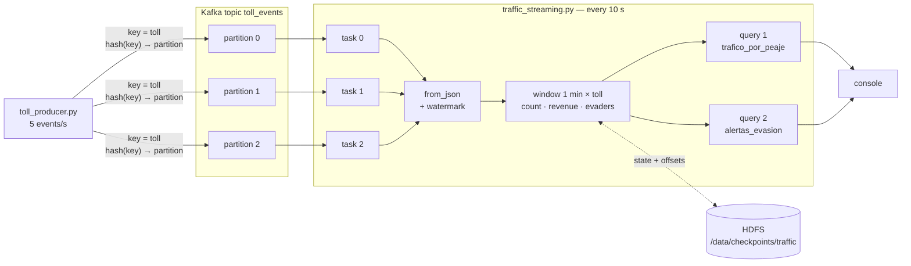
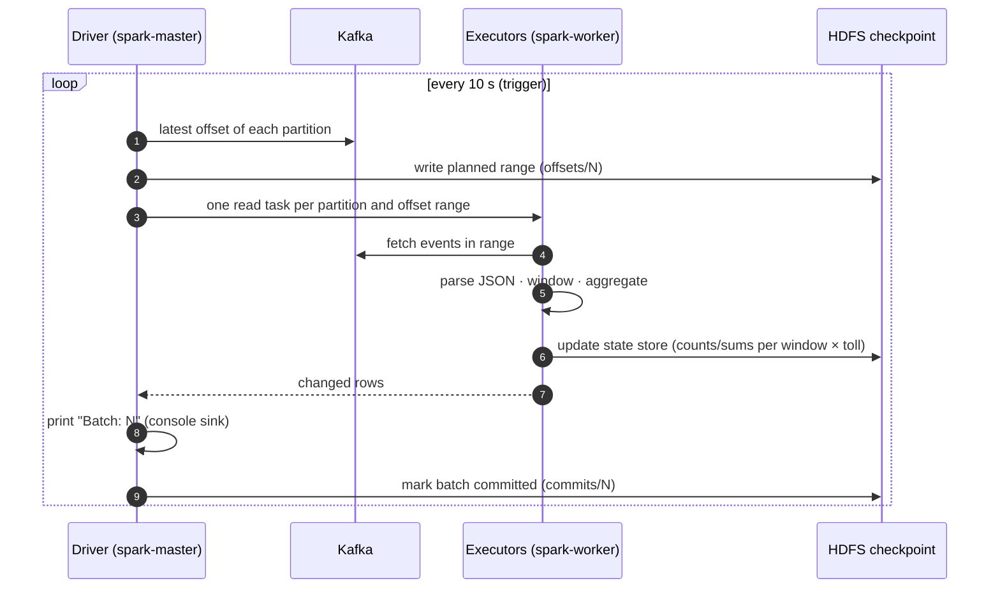

# Streaming pipeline — `toll_producer.py` → Kafka → `traffic_streaming.py`

**Goal:** monitor toll traffic as it happens — vehicles, revenue and evasion per toll
every minute — and raise an alert when a toll's evasion rate spikes.

It follows the producer/consumer pattern of the course's Anexo 3 (`kafka_producer.py` +
`spark_streaming_consumer.py`), applied to the same domain as the batch analysis.



## 1 · The producer

Runs inside `spark-master` (it already has Python and `kafka-python`) and connects to
`kafka:29092`.

Each event is one vehicle passing a toll:

```json
{"event_id": "a35e43c3-…", "peaje": "CHUSACA", "categoria": "II",
 "valor_tarifa": 19000, "evade": false, "timestamp": "2026-10-28T00:36:11"}
```

| Field | Source |
|---|---|
| `peaje` | Top tolls of the batch analysis + the two evasion hotspots (Puente Amarillo, San Pedro) |
| `categoria` | Random, weighted by the category shares found in batch (I = 63 %, II = 13 %, …) |
| `valor_tarifa` | Simulated tariff per category |
| `evade` | Random: 8 % in the two hotspots, 1 % elsewhere (amplified so it shows in a short demo) |
| `timestamp` | Event time, container clock (**UTC**: Bogotá + 5 h) |

**Key = toll name.** Kafka hashes the key to pick the partition, so all events of one
toll always land in the same partition and keep their order. Different tolls spread
across the 3 partitions, which lets Spark read them in parallel.

Options: `--rate` (events/s, default 5), `--topic`, `--bootstrap`.

## 2 · Kafka in this project

| Concept | Anexo 3 | This project |
|---|---|---|
| Coordination | ZooKeeper + broker (two processes) | KRaft: the broker manages its own metadata |
| Broker | `localhost:9092` | `kafka:29092` (containers) · `localhost:9092` (host) |
| Topic | `sensor_data`, 1 partition | `toll_events`, 3 partitions, replication factor 1 |
| Producer | `kafka_producer.py`, sensor readings, no key | `toll_producer.py`, toll events, key = toll |
| Consumer | `spark_streaming_consumer.py` | `traffic_streaming.py` |

Kafka keeps events after they are read (retention), so several consumers can read the
same topic independently, and a restarted consumer can continue from an offset.

## 3 · How each micro-batch runs

Structured Streaming treats the topic as an **unbounded table** and runs the same
DataFrame code on each new slice of it.



Offsets live in the **checkpoint**, not in Kafka: after a restart the query resumes
exactly after the last committed batch. `--starting-offsets` (`latest` by default) only
applies the first time, when no checkpoint exists.

## 4 · Windows and watermark

```python
events.withWatermark("timestamp", "2 minutes")
      .groupBy(F.window("timestamp", "1 minute"), "peaje")
      .agg(count, sum(revenue if paid), sum(evaders))
```

- **Window (1 minute, event time):** each event goes to the bucket of the minute in
  which the vehicle passed (`00:36:00–00:37:00`), not the minute in which Spark
  received it.
- **Watermark (2 minutes):** Spark tracks the newest event time seen. Anything older
  than *newest − 2 min* is considered too late: it is dropped and the windows that end
  before that point are finalized and removed from the state store.

Worked example (newest event seen = `00:39:30` → watermark = `00:37:30`):

| Event time | Window | What happens |
|---|---|---|
| `00:39:10` | 00:39–00:40 | Counted, window still open |
| `00:37:50` | 00:37–00:38 | Counted (late, but after the watermark) |
| `00:36:40` | 00:36–00:37 | Dropped: window already closed by the watermark |

Without a watermark (as in the annex) Spark must keep every window forever, so memory
grows for as long as the job runs.

## 5 · Output modes

| Mode | Prints per batch | Needs watermark | Used |
|---|---|---|---|
| `complete` | The whole result table every time | No (state grows forever) | Anexo 3 |
| `update` | Only rows that changed in this batch | Recommended | **This project** |
| `append` | Only finalized windows, once | Yes | Not used (rows would appear ≥ 2 min late) |

That is why the same window and toll appear in several consecutive batches with growing
counts: each batch shows its latest value.

## 6 · The two queries

| Query | Logic | Checkpoint |
|---|---|---|
| `trafico_por_peaje` | Per window × toll: `vehiculos`, `recaudo` (only paying vehicles), `evasores`, `evasion_pct` | `/data/checkpoints/traffic/per_toll` |
| `alertas_evasion` | Same rows filtered by `vehiculos >= 5` **and** `evasion_pct >= 5`; adds `alerta = EVASION ALTA` | `/data/checkpoints/traffic/alerts` |

The 5-vehicle minimum avoids false alarms from tiny samples (1 vehicle that evades =
100 %), the same reasoning as the 1-million-vehicle threshold in the batch ranking.

## 7 · Reading the console

| You see | Meaning |
|---|---|
| `Batch: N` with a table | One micro-batch of one of the two queries |
| A table with only headers | No rows changed (or no alerts) in that batch — normal in `update` mode |
| Same toll and window in several batches | The window is still open and its counts keep growing |
| `Current batch is falling behind…` | The batch took longer than the 10 s trigger — normal in the first batches (connector download, executor start-up, first checkpoint); if it persists, use `--trigger "15 seconds"` |
| Times 5 h ahead of Bogotá | Containers run in UTC |

In `http://localhost:4040` → **Structured Streaming**: input rate vs processing rate
and duration per batch for each query.

## 8 · Differences from Anexo 3

| Anexo 3 | This project | Why |
|---|---|---|
| Two `SparkSession` builders | One | The second one was redundant |
| `outputMode("complete")`, no watermark | `update` + 2-minute watermark | Bounded state |
| No checkpoint | Checkpoint in HDFS | Recovery after restart; required storage for stateful queries in a cluster |
| `sensor_data`, 1 partition, no key | `toll_events`, 3 partitions, key = toll | Shows partitioning and per-key ordering |
| One query | Aggregation + alerts | Shows reacting to the stream, not only counting |
| `kafka-python 2.0.2` | `2.2.21` | 2.0.2 fails on Python ≥ 3.12 |