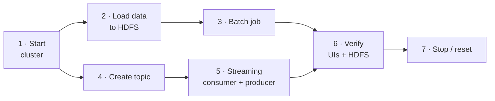

# Runbook

Every command in execution order, from an empty machine to both pipelines running,
plus a demo script. Run everything from the repository root.



## 1 · Start the cluster

```bash
chmod 777 reports reports/figures         # first time only
docker compose up -d --build
docker compose ps                          # namenode "healthy", the rest "running"
```

Check: http://localhost:9870 (1 live DataNode) and http://localhost:8080 (1 worker `ALIVE`).

## 2 · Load the data into HDFS

```bash
curl -L -o data/trafico_ani.csv \
  "https://www.datos.gov.co/resource/8yi9-t44c.csv?\$limit=200000"
wc -l data/trafico_ani.csv                 # 149945 (rows + header)
./scripts/load_to_hdfs.sh data/trafico_ani.csv /data
```

`$limit` is mandatory: without it the API returns only 1,000 rows. The script copies
the file into the `namenode` container, uploads it with `hdfs dfs -put` and opens write
permissions on `/data` for the `spark` user.

## 3 · Batch job

```bash
docker exec spark-master /opt/spark/bin/spark-submit \
  --master spark://spark-master:7077 \
  /scripts/analyze_traffic.py 2>&1 | tee reports/run_batch.log
```

Check:

```bash
ls reports/figures/                                          # 5 PNG charts
docker exec namenode hdfs dfs -ls /data/output/trafico       # 5 folders
grep -v -E "WARN|INFO|Stage|^\s*at " reports/run_batch.log | sed -n '/Perfil/,/Top 5/p'
```

## 4 · Kafka topic

The topic lives inside the `kafka` container: create it again after
`docker compose down`.

```bash
docker exec kafka /opt/kafka/bin/kafka-topics.sh --create --if-not-exists \
  --bootstrap-server kafka:29092 --topic toll_events \
  --partitions 3 --replication-factor 1
docker exec kafka /opt/kafka/bin/kafka-topics.sh --describe \
  --bootstrap-server kafka:29092 --topic toll_events
```

## 5 · Streaming (two terminals, consumer first)

The batch job must have finished: both jobs share the worker's cores.

**Terminal 1 — consumer:**

```bash
docker exec -it spark-master /opt/spark/bin/spark-submit \
  --master spark://spark-master:7077 \
  --packages org.apache.spark:spark-sql-kafka-0-10_2.12:3.5.3 \
  --conf spark.jars.ivy=/tmp/.ivy2 \
  /scripts/traffic_streaming.py
```

Wait for `Streaming from 'toll_events'`.

**Terminal 2 — producer:**

```bash
docker exec -it spark-master python3 /scripts/toll_producer.py --rate 10
```

Let both run ≥ 2 minutes so windows fill up and alerts appear. Stop both with `Ctrl+C`.

Useful options:

| Script | Option | Default |
|---|---|---|
| `traffic_streaming.py` | `--window` · `--trigger` · `--alert-pct` · `--starting-offsets` | `1 minute` · `10 seconds` · `5.0` · `latest` |
| `toll_producer.py` | `--rate` · `--topic` · `--bootstrap` | `5` · `toll_events` · `kafka:29092` |

## 6 · Verify

```bash
# raw events in Kafka (key = toll)
docker exec kafka /opt/kafka/bin/kafka-console-consumer.sh \
  --bootstrap-server kafka:29092 --topic toll_events \
  --from-beginning --max-messages 5 --property print.key=true

# streaming checkpoints in HDFS
docker exec namenode hdfs dfs -ls /data/checkpoints/traffic
```

| UI | Where to look |
|---|---|
| http://localhost:4040 | Batch: **Jobs** → a job → DAG. Streaming: **Structured Streaming** tab |
| http://localhost:8080 | The running application and its cores |
| http://localhost:9870 | Utilities → Browse the file system → `/data` |

## 7 · Stop and reset

| Goal | Command |
|---|---|
| Stop containers, keep everything | `docker compose stop` |
| Remove containers, keep HDFS data | `docker compose down` (recreate the Kafka topic afterwards) |
| Restart streaming from scratch | `docker exec namenode hdfs dfs -rm -r -f /data/checkpoints/traffic` |
| Wipe everything, HDFS included | `docker compose down -v` |

---

## Demo script (2 videos, ≤ 5 min each)

**Before recording:** cluster up, data loaded, topic created, browser tabs on 9870,
8080 and 4040. To keep `:4040` alive after the batch job ends, temporarily add
`input("Press Enter...")` before `spark.stop()` in `analyze_traffic.py` (do not commit it).

### Video 1 — batch

| Time | Show | Explain |
|---|---|---|
| 0:00 | README on GitHub (big-picture diagram) | Problem, dataset, Docker as equivalent of the course VM |
| 0:30 | `docker compose ps`, HDFS UI → `/data` | Services and the data already in HDFS |
| 1:00 | `analyze_traffic.py` | Schema, profile, cleaning; DataFrame vs Spark SQL vs RDD |
| 2:15 | Run `spark-submit` | Quality profile, yearly summary, rankings, RDD output |
| 3:15 | `:4040` → Jobs → DAG | One job per action, stages split at shuffles |
| 3:45 | `reports/figures/` | Findings + caveats ([batch doc](02-batch-pipeline.md#results)) |
| 4:45 | `hdfs dfs -ls /data/output/trafico` | Results persisted in HDFS |

### Video 2 — real time (Anexo 3)

| Time | Show | Explain |
|---|---|---|
| 0:00 | Diagram of [streaming doc](03-streaming-pipeline.md) | Producer → topic (3 partitions) → Spark; KRaft instead of ZooKeeper |
| 0:30 | `kafka-topics.sh --describe` | Partitions, leader, replication factor 1 |
| 1:00 | `toll_producer.py` | Event fields; key = toll → same partition |
| 1:45 | `traffic_streaming.py` | Window, watermark, `update` mode, HDFS checkpoints, alerts |
| 2:45 | Both terminals side by side | Batches growing per window; an alert appearing; why San Pedro with 1 vehicle at 100 % does not alert |
| 4:15 | `:4040` → Structured Streaming | Input rate, batch duration, the initial "falling behind" warning |