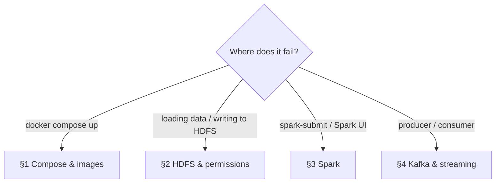

# Troubleshooting

Problems found while building this project, plus the most likely ones when running it.

## 1 · Compose and images

| Symptom | Cause | Fix |
|---|---|---|
| `service "namenode" refers to undefined volume` | `volumes:` not declared as a top-level key | Put `volumes:` at the same indentation as `services:` |
| `mapping key "image" already defined` | A service block (e.g. `kafka:`) indented 4 spaces instead of 2, so it became part of the previous service | Align it with the other services; validate with `docker compose config --quiet` |
| `the attribute version is obsolete` | Compose v2 ignores `version:` | Delete the line (warning only) |
| `bitnami/spark:3.5: not found` | Bitnami stopped publishing free tags (2025) | Use the official `apache/spark` image |
| `No matching distribution found for pandas==…` | Base image runs **Python 3.8** | Keep `pandas==2.0.3`, `matplotlib==3.7.5` |
| `container name "/namenode" is already in use` | Containers created under another Compose project name (folder renamed) | `docker compose -p <old-name> down`, then `docker compose up -d` |
| `namenode` never `healthy` | Stale volume from a different `CLUSTER_NAME` | `docker compose down -v` (**deletes HDFS data**) |

## 2 · HDFS and permissions

| Symptom | Cause | Fix |
|---|---|---|
| `./scripts/load_to_hdfs.sh: Permission denied` | Script lost its executable bit | `chmod +x scripts/load_to_hdfs.sh` |
| Job fails at `mkdirs` — `AccessControlException: user=spark, access=WRITE, inode="/data"` | Data uploaded as `root` (dir `755`), driver runs as `spark` | Already handled by `load_to_hdfs.sh`; manually: `docker exec namenode hdfs dfs -chmod -R 777 /data` |
| Charts not written to `reports/figures/` | Container user (uid 185) cannot write a host folder owned by uid 1000 | `chmod 777 reports reports/figures` |
| `wc -l` returns 1001 | `$limit` missing or not escaped in the URL | Use `\$limit=200000` |

## 3 · Spark

| Symptom | Cause | Fix |
|---|---|---|
| `"spark-submit": executable file not found in $PATH` | Official image does not add `/opt/spark/bin` to `PATH` | `docker exec spark-master /opt/spark/bin/spark-submit …` |
| `can't open file '/scripts/…'` or port 4040 unreachable | Container created before the current `volumes:`/`ports:`; `restart` does not re-read the compose file | `docker compose up -d --force-recreate spark-master spark-worker` |
| `localhost:4040` refuses connection | The driver UI only exists while an application runs | Open it during the job, or hold the driver with a temporary `input()` |
| New job stuck in `WAITING`, 0 cores | Another driver (paused batch job or the streaming job) holds all cores | Stop it with `Ctrl+C`; if orphaned: `docker exec spark-master ps aux \| grep java` and `kill` the PID. The UI "kill" link only works in cluster mode |
| `Initial job has not accepted any resources` | Worker not registered or busy | Check http://localhost:8080 for an `ALIVE` worker with free cores |

## 4 · Kafka and streaming

| Symptom | Cause | Fix |
|---|---|---|
| `NoBrokersAvailable` / connection refused from a script in a container | Used `localhost:9092`; inside a container `localhost` is the container itself | Use `kafka:29092` (INTERNAL listener) |
| `basedir must be absolute: ?/.ivy2/local` on `--packages` | User `spark` has no writable home for the Ivy cache | Add `--conf spark.jars.ivy=/tmp/.ivy2` |
| `Failed to find data source: kafka` | Connector missing or version mismatch | `--packages org.apache.spark:spark-sql-kafka-0-10_2.12:3.5.3` (Scala 2.12, Spark 3.5.3) |
| Topic has 1 partition instead of 3 | Producer started before the topic was created; the broker auto-created it with defaults | Delete it (`kafka-topics.sh --delete …`) and recreate with `--partitions 3`, then reset checkpoints |
| Consumer prints only empty batches | Producer not running, or `startingOffsets=latest` skipped old events | Start the producer after the consumer; to reprocess, reset checkpoints and use `--starting-offsets earliest` |
| `--starting-offsets` has no effect | A checkpoint exists, so the query resumes from it | `docker exec namenode hdfs dfs -rm -r -f /data/checkpoints/traffic` |
| `Current batch is falling behind` | Batch took longer than the trigger (first batches: start-up, connector download) | Normal at start; if persistent, `--trigger "15 seconds"` |
| Times 5 h ahead of local time | Containers run in UTC | Expected; mention it when presenting |
| `ModuleNotFoundError: kafka.vendor.six` | `kafka-python 2.0.2` on Python ≥ 3.12 | Use `kafka-python==2.2.21` (already in the image) |